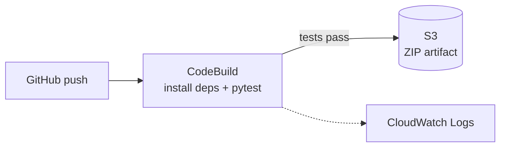
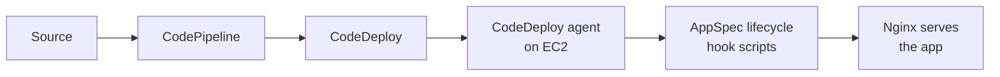
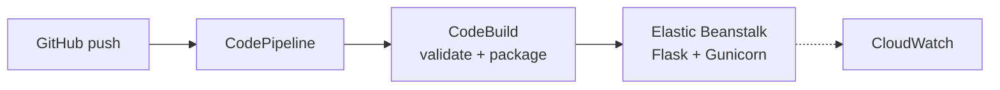
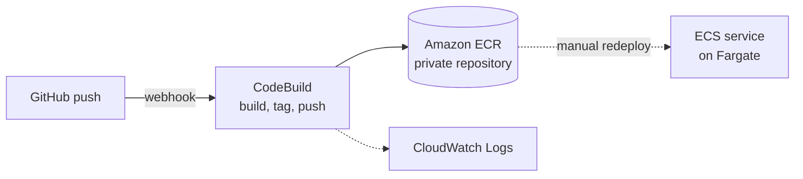

# AWS Projects

**Four hands-on projects that take an application from a tested build to a container running on AWS Fargate.**

`AWS CI/CD` · `Docker` · `Amazon ECR` · `ECS Fargate` · `Python` · `Flask`

[Projects](#projects) · [Pipelines](#how-each-pipeline-works) · [Structure](#repository-structure) · [Skills](#skills-demonstrated) · [Roadmap](#roadmap) · [Notes](#notes)

---

## What this is

A portfolio of AWS, Cloud, and DevOps projects focused on **CI/CD, deployment, containerization, and monitoring**. Each one is built and run on real AWS services, and each project folder has its own README covering architecture, configuration, implementation steps, test results, and cleanup.

The projects build on each other:

1. **Build and test** automatically on every push.
2. **Deploy** to a server you manage (EC2).
3. **Deploy** to a managed platform (Elastic Beanstalk).
4. **Ship a container** through a registry and run it on Fargate.

## Projects

| # | Project | Trigger | Ends up in | Stack |
|---|---|---|---|---|
| 1 | [CodeBuild Python CI Demo](01-codebuild-python-demo/) | GitHub | ZIP artifact in S3 | CodeBuild · Python · Flask · pytest · S3 · CloudWatch Logs · IAM |
| 2 | [CodeDeploy EC2 Application Deployment](02-codedeploy-ec2/) | CodePipeline | EC2 instance | CodePipeline · CodeDeploy · EC2 · Nginx · IAM |
| 3 | [Elastic Beanstalk CI/CD](03-elastic-beanstalk/) | GitHub | Elastic Beanstalk environment | CodePipeline · CodeBuild · Elastic Beanstalk · Python · Flask · Gunicorn · IAM · CloudWatch |
| 4 | [Containerized CI/CD Pipeline](04-docker-ecr-cicd/) | GitHub webhook | Private ECR repository, then ECS Fargate | Docker · CodeBuild · ECR · ECS · Fargate · Python · Flask · Gunicorn · IAM · CloudWatch |

### 1. CodeBuild Python CI Demo

A GitHub-triggered CI pipeline. CodeBuild installs dependencies, runs `pytest`, and publishes a ZIP artifact to S3 only when the tests pass.

### 2. CodeDeploy EC2 Application Deployment

In-place deployment to an EC2 instance using the CodeDeploy agent, an AppSpec file, and lifecycle hook scripts, orchestrated by CodePipeline.

### 3. Elastic Beanstalk CI/CD

A GitHub-triggered build and deployment pipeline for a Flask application on Elastic Beanstalk. CodeBuild validates and packages the app, then CodePipeline deploys it to the configured environment.

### 4. Containerized CI/CD Pipeline

A GitHub webhook triggers CodeBuild to build, tag, and push a Docker image to a private ECR repository. The image was also deployed and tested as an ECS Fargate service.

> **Current status:** the GitHub → CodeBuild → ECR pipeline is automated. ECS redeployment is still a separate, manual step. Automating it through CodePipeline is on the [roadmap](#roadmap).

## How each pipeline works

### 1. CodeBuild Python CI Demo




### 2. CodeDeploy EC2 Application Deployment




### 3. Elastic Beanstalk CI/CD




### 4. Containerized CI/CD Pipeline



Solid arrows are automated. Dashed arrows are manual or supporting steps.


## Repository structure

```text
AWS-Projects/
├── README.md
│
├── 01-codebuild-python-demo/
│   ├── app.py
│   ├── buildspec.yml
│   ├── requirements.txt
│   ├── test_app.py
│   └── README.md
│
├── 02-codedeploy-ec2/
│   ├── appspec.yml
│   ├── scripts/
│   └── README.md
│
├── 03-elastic-beanstalk/
│   ├── application.py
│   ├── buildspec.yml
│   ├── requirements.txt
│   └── README.md
│
└── 04-docker-ecr-cicd/
    ├── app.py
    ├── requirements.txt
    ├── Dockerfile
    ├── buildspec.yml
    ├── .dockerignore
    └── README.md
```

*The tree shows the main project files. Individual folders may contain additional configuration or deployment files.*

## Skills demonstrated

| Area | What it covers | Where |
|---|---|---|
| **Continuous Integration** | GitHub webhooks, CodeBuild, `buildspec` configuration, automated testing, build logs | [1](01-codebuild-python-demo/) · [3](03-elastic-beanstalk/) · [4](04-docker-ecr-cicd/) |
| **Continuous Delivery and Deployment** | CodePipeline, CodeDeploy, EC2 deployments, Elastic Beanstalk deployments | [2](02-codedeploy-ec2/) · [3](03-elastic-beanstalk/) |
| **Containerization** | Dockerfiles, Docker images, container ports, dependency management, image tagging | [4](04-docker-ecr-cicd/) |
| **Container Registry** | ECR authentication, private repositories, image push and pull | [4](04-docker-ecr-cicd/) |
| **Container Orchestration** | ECS clusters, task definitions, services, networking, Fargate | [4](04-docker-ecr-cicd/) |
| **Security and Access Management** | IAM roles, trust relationships, service permissions, security groups | All projects |
| **Monitoring and Troubleshooting** | CloudWatch logs, application health endpoints, debugging build and deployment failures | [1](01-codebuild-python-demo/) · [3](03-elastic-beanstalk/) · [4](04-docker-ecr-cicd/) |


## Author

**Dhruv Rajput** · [GitHub](https://github.com/DHRUVRAJPUTTT)